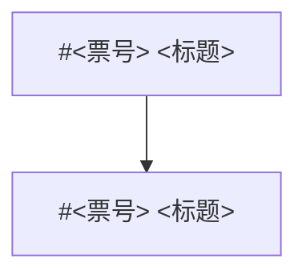

# 建票：步骤与正文模板

本仓库的 Spec 和任务票均为 GitHub issue，`gh` 用法与标签见 [issues.md](./issues.md)。新建 Spec 或票按以下流程执行。

## 类型区分

- **Spec**：一组票的总说明，包含问题、方案、作者决定与票清单，自身不直接实现；标题以 `Spec：` 开头（如 `#11`）。
- **任务票**：一次可独立推送、验收、关闭的完整交付，挂在父 Spec 下；功能、界面、重构、修 bug 共用模板。
- **作者票**：仅作者本人可完成的事（真机验证、扫码、外部服务配置），标题以 `【作者】` 开头，打 `ready-for-human`。

## 建票步骤

1. **定归属**：`gh issue list --state open` 定位父 Spec 及前置依赖票；一组相互依赖的新工作尚无 Spec 时先建 Spec。
2. **查依据**：
   - 命名统一遵循 [术语表](../product/glossary.md)；
   - 查阅相关 [ADR](../adr/)、[产品规则](../product/rules.md)、[设计规范](../design/) 及 Spec 对应章节；
   - 涉及网易云新字段时核对 `node_modules/hana-music-api/dist/client.generated-*.d.ts`（[ADR-0005](../adr/0005-hana-music-api-co-evolution.md)），缺失则先建 SDK issue 并标阻塞。
3. **消歧义**：存在多种方案且文档与代码未决时先问作者，定论写入“讨论结论”；正文不留“待定 / 看情况”，确需开工核对的接口单列推荐与代码依据。
4. **写正文与发布**：按下方模板删去无关小节，正文写入临时文件后用 `gh issue create --body-file` 发布；Spec 先于子票、被依赖票先于依赖票发布，发布后用 [issues.md](./issues.md) 命令挂 sub-issue 和原生 `blocked_by` 依赖，并验证 `gh issue view` 渲染与依赖计数正确。

## 标题与标签规则

标题格式：`<领域或画面>：<听众可观察的结果>`（多件事用顿号隔开，不加 `feat:` 等 commit 前缀）。每张票只打一个分诊标签（`ready-for-agent` 或 `ready-for-human`）。

## 任务票模板

```text
## Parent

#<Spec 号>

## 顺序与依赖

<串行第 N 张（共 M 张，顺序见 #<Spec 号>）。等 #a（原因）、#b（原因）。>

## 背景

<起因与目标。>

现状：

- `<文件>:<行>`：<当前行为与问题>
- <与 ADR 或 docs/design/ 不一致处>

## 证据

<重构票写：之前 / 之后对照，可附 mermaid。>

## 删除测试

<重构票写：删除该模块后复杂度去向。>

## 讨论结论（作者 YYYY-MM-DD 定）

1. <结论>

## 方案

### 1. <第一块>

- <听众可见行为>
- <实现要点：组件、接口、数值>

## 开工时要先定的接口（写进开工清单给作者确认）

- <接口>：推荐 <做法>，依据 <`文件:行`>；备选 <做法>（<不选原因>）

## 组件与文件

- `<文件>`：<改动说明>
- `docs/design/` / `docs/product/` / `docs/adr/`：<同步更新的文档>
- 不改：<明确不碰的模块、API、录制>

## 不做什么

- <容易误判在范围内但本票不做的内容>

## 测试与验证

- 测试：<按 testing.md 盘点受影响调用方与行为分支，对应接入点与回归文件；不新增测试时写原因与已有回归>
- 试用清单要点：<作者需试用的路径、期望与自动化未覆盖项>

## Acceptance criteria

- [ ] <听众可观察的结果，一条一件事>
- [ ] 受影响的 `docs/design/`、`docs/product/`、`docs/adr/` 与 Spec 已同步更新
- [ ] 需求、调用方与行为分支测试覆盖清单已核对；自动化边界外项已列进作者试用清单
- [ ] `pnpm check`、`pnpm fmt:check`、`pnpm lint`、`pnpm test`、`pnpm build` 通过
- [ ] 推送 `rewrite/v1`，最终提交 CI 与 Vercel 通过；票内留言含 SHA、摘要、测试覆盖与试用清单

## 实现约定

先读 `docs/agents/delivery.md` 和 `docs/agents/testing.md`。分支 `rewrite/v1`，主动跟进最终提交 CI 与部署结果；CI 失败按 `delivery.md` 的 fixup、autosquash 和 force-with-lease 流程修复，通过后在票内留试用清单。实现者默认不开浏览器，真账号仅留给作者交付试用。文中行号以开工时代码为准。
```

### 按票类补充要点

| 类型         | 额外要求                                                                                                                                               |
| ------------ | ------------------------------------------------------------------------------------------------------------------------------------------------------ |
| 修 bug       | “背景”写复现步骤、实际与期望；“方案”第一步先在正确接入点写失败测试复现                                                                                 |
| 重构         | 补“证据”“删除测试”；实现约定加“听众可见行为不变（明确列出者除外）”                                                                                     |
| 界面         | “方案”写清尺寸、文案、加载/空/错态、动效档位、键盘焦点与减少动态效果（用 `docs/design/` 既有档位）；验证含桌面 1440×900、手机 390×844 及 768/1024 抽查 |
| 新测试接入点 | 写清输入输出契约，并同步更新 `docs/agents/testing.md`                                                                                                  |

跨仓库引用写全称，如 `nonhana/hana-music-api#43`。仅存作者本机的材料（`_notes/`、本机截图）不贴本地路径，标明“本机参考，不随票附”。

## Spec 模板

````text
## Problem Statement

<听众或作者遇到的问题。>

## Solution

<从听众视角描述解决方案。>

## 作者的决定（YYYY-MM-DD）

1. <决定>

## User Stories

1. 作为<谁>，我想要<什么>，以便<为什么>。

## Implementation Decisions

- <模块、接口、规则与上游约定>

## Testing Decisions

- <测试标准、覆盖模块与接入点>

## 共同规矩（每张票都适用）

- <共享约束>

## Tickets（按顺序做）

- [ ] #<票号> <标题>（等 #<票号>）



## Out of Scope

- <明确不做>

## Further Notes

- <确认不动之处、顺路发现的缺陷归属、与其他 Spec 的关系>
````

产品 Spec 的 User Stories 修改时就地更新文字、不重排编号；长期演进的根 Spec（如 `#11`）可省略 Tickets 清单。
