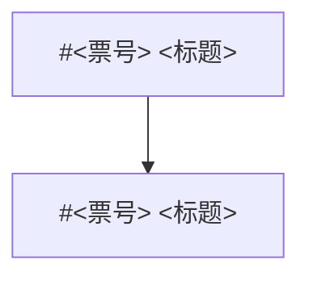

# 建票：步骤和正文模板

本仓库的 Spec 和票都是 GitHub issue，`gh` 的用法见 [issue-tracker.md](issue-tracker.md)。新建 Spec 或票都按这里走。用 `/to-spec`、`/to-tickets` 发布时，正文也换成这里的模板；它们说的“不写文件路径”在本仓库不适用，见“每一节写什么”的“背景”。

## Spec 和票

- **Spec**：一组票的总说明，写问题、方案、作者的决定和票的清单，自己不实现。标题以“Spec：”开头。例：#11（产品）、#60（架构整理）。
- **票**：一次完整的交付，做完能推送、试用、关掉，挂在一张 Spec 下面。功能、界面、重构、修 bug 都是票，用同一个模板，区别只在多写哪几样，见“按种类多写什么”。例：#80（界面）、#73（重构）、#79（功能）。
- **作者的票**：只有作者能亲手做的事（真机、扫码、在官方 App 上对照、删外部服务），标题以“【作者】”开头，打 `ready-for-human`。例：#12、#13。

## 步骤

1. **定归属。** 用 `gh issue list --state open` 找开着的 Spec，定这张票挂在哪张下面、要等哪几张票。一组相互依赖的新工作还没有 Spec 时，先写 Spec。

   完成：知道 Parent 的票号；要等的每张票都有一句原因。

2. **查依据。**
   - 标题和正文用 `GLOSSARY.md` 的词（[domain.md](domain.md)）。
   - 读要动的区域相关的 ADR、`DESIGN.md` 和 Spec 的相关章节，先 grep 再读那几段。
   - 界面票：布局、文案，以及加载中、空、出错的样子，从视觉原型源码读（`campanula-ui-acceptance` skill 第 1 步）。
   - 要用网易云还没用过的字段：查 `node_modules/hana-music-api/dist/client.generated-*.d.ts` 有没有声明。没有就先开 SDK 票，这张票标成被它阻塞（ADR-0005）。

   完成：“背景”里每条现状都有出处（`文件:行`、文档章节或票号）；和 ADR、原型、`DESIGN.md` 不一样的地方都点了名。

3. **把没定的问完。** 有两种以上做法、代码和文档又答不了的，先问作者，定下来写进“讨论结论”。

   完成：正文里没有“待定”“可选”“看情况”，实现者照着做不用再问作者。确实要等开工时才能定的接口，单列在“开工时要先定的接口”。

4. **写正文。** 复制“票的模板”或“Spec 的模板”，删掉用不到的节，每节按“每一节写什么”写。

   完成：留下的每一节都有内容；验收标准的每一条，都能在 mock、测试或命令输出里看到结果。

5. **发布。** Spec 先发；一组票按依赖顺序发，被等的先发，这样阻塞能写真的票号。

   ```sh
   gh issue create --title "<标题>" --label ready-for-agent --body-file <正文文件>
   # 挂到 Spec 下面（sub-issue）；sub_issue_id 是数字 id，不是票号
   gh api --method POST repos/nonhana/campanula-music/issues/<Spec 号>/sub_issues \
     -F sub_issue_id="$(gh api repos/nonhana/campanula-music/issues/<票号> --jq .id)"
   ```

   - 正文先写进临时文件再用 `--body-file`。正文里的反引号和 `$` 放进 `--body` 会被 shell 展开。
   - 有要等的票：按 [issue-tracker.md](issue-tracker.md)「阻塞」加原生依赖，正文“顺序与依赖”里也写。
   - Spec 有“Tickets”清单的，把新票补进去。

   完成：`gh issue view <票号>` 里标题、标签对，正文渲染正常（标题层级、复选框、代码块、mermaid）；`gh api repos/nonhana/campanula-music/issues/<票号> --jq '[.parent_issue_url, .issue_dependencies_summary.total_blocked_by]'` 给出的是 Spec 的地址和要等的票数。

## 标题和标签

标题写 `<领域或画面>：<做成什么>`。领域用 GLOSSARY 的词；冒号后面写听众看得到的结果，几件事用顿号隔开；不加 `feat:` 这类前缀。

- 播放页歌词：文字可选中、行内跳转胶囊、当前行放大不换行
- 加入歌单：规则进 App，选择器只留一个，菜单壳自己算行高
- 【作者】验证关卡⑨：在官方 App 上对照规则①②⑤⑨

标签的含义见 [triage-labels.md](triage-labels.md)。写全了、实现者不用再问就能做的打 `ready-for-agent`；只有作者能亲手做的打 `ready-for-human`。一张票只打一个。

## 票的模板

```text
## Parent

#<Spec 号>

## 顺序与依赖

<串行第 N 张（共 M 张，顺序见 #Spec 号）。等 #a（原因）、#b（原因）。>

## 背景

<谁在哪天报告了什么，或者为什么要做。>

现状：

- `<文件>:<行>`：<现在是怎样的，哪里不对>
- <和 ADR、原型、DESIGN.md 不一样的地方>

## 证据

<重构票写：之前 / 之后，可以画 mermaid。>

## 删除测试

<重构票写：删掉这个模块，复杂度会去哪。>

## 讨论结论（作者 YYYY-MM-DD 定）

1. <结论>

## 方案

### 1. <第一块>

- <听众看得到的行为>
- <实现要点：组件、接口、数值>

## 开工时要先定的接口（写进开工清单给作者确认）

- <要定的接口形状>

## 组件与文件

- `<文件>`：<改什么>
- `DESIGN.md`：<哪几节改成什么>
- Spec #<号>：<第几条用户故事改成什么>
- ADR：<新增或修改哪条；不新增时写原因>
- 不改：<不该碰的模块、API、录制数据>

## 不做什么

- <读者容易以为在范围内、但这张票不做的>

## 测试与验证

- 测试：<写在哪个接入点（delivery.md 第 2 步），覆盖哪些情况；不加测试时写原因>
- mock 自查：<去哪、做什么、应该看到什么>

## Acceptance criteria

- [ ] <听众看得到的结果，一条一件事>
- [ ] `DESIGN.md`、Spec、ADR、GLOSSARY 里受影响的地方已更新
- [ ] `pnpm check`、`pnpm lint`、`pnpm test`、`pnpm build` 通过
- [ ] 推送 `rewrite/v1`，这次提交的 CI 和 Vercel 都是 success；票里留言写清提交、做了什么、测试覆盖了什么，附试用清单

## 实现约定

用 `/implement` 在新会话里做，先读 `docs/agents/delivery.md`。分支 `rewrite/v1`，推送后确认 CI 和 Vercel，在票里留试用清单。界面自查走 mock；真账号只留给作者最后的交付试用。文中行号是写票时的位置，开工时以当时的代码为准。
```

## 每一节写什么

| 节 | 什么时候写 | 写到什么程度 |
|---|---|---|
| Parent | 票都写；Spec 不写 | 只写 `#号` |
| 顺序与依赖 | 有要等的票，或 Spec 定了先后 | 每张要等的票写原因；同时加原生依赖 |
| 背景 | 都写 | 现状每条有出处，写 `文件:行`、文档章节或票号；偏离 ADR、原型、`DESIGN.md` 的点名，说清是谁哪天定的。只在作者本机的材料（`_notes/`、截图、审查报告）不贴路径，写“本机参考，不随票附” |
| 证据、删除测试 | 重构票 | 见“按种类多写什么” |
| 讨论结论 | 和作者讨论过 | 编号、带日期。它是这张票的依据，后面的方案不能和它冲突 |
| 方案 | 都写 | 先写听众看得到的行为，再写实现要点；分几块的按实现顺序编号 |
| 开工时要先定的接口 | 有新接口、写票时不宜定死 | 列出要定的形状；实现者在开工清单里给方案，作者确认后再写代码 |
| 组件与文件 | 改动跨几个文件，或要改文档 | 要改的文件；`DESIGN.md`、Spec 用户故事、ADR、GLOSSARY 各改什么；“不改”的范围 |
| 不做什么 | 都写 | 读者容易以为在范围内的事 |
| 测试与验证 | 都写 | 测试写在哪个接入点、覆盖哪些情况，或者为什么不加；mock 自查要做的事 |
| Acceptance criteria | 都写 | 复选框，每条一件能观察到的事。模板里后三条（文档、命令、交付）是固定的；不涉及文档时删掉文档那一条 |
| 实现约定 | 都写 | 模板里那段照抄；本票特有的约定（串行、行为不变、用最强的模型）加在后面 |

引用别的仓库的票写全称，例如 `nonhana/hana-music-api#43`。

## 按种类多写什么

| 种类 | 多写什么 | 例 |
|---|---|---|
| 修 bug | “背景”里写复现：步骤、实际看到什么、应该是什么。“方案”第一步是先写一条会失败的测试复现，再修 | #64 |
| 重构 | “证据”写之前 / 之后；“删除测试”写删掉这个模块会怎样；“实现约定”加一句“听众看得到的行为不变（下面写明要变的除外）” | #73 |
| 界面 | “方案”写到尺寸、文案、加载中 / 空 / 出错、动效时长、焦点和键盘、减少动态效果，数值用 `DESIGN.md` 已有的档；“测试与验证”写桌面 1440×900、手机 390×844，抽查 768、1024 | #80 |
| 新的测试接入点 | “测试与验证”写清接入点的输入和输出，并要求把它写进 `delivery.md` 第 2 步 | #79 |

## Spec 的模板

````text
## Problem Statement

<听众或作者遇到的问题，从他们的角度写。>

## Solution

<从听众的角度写怎么解决。>

## 作者的决定（YYYY-MM-DD）

1. <决定>

## User Stories

1. 作为<谁>，我想要<什么>，以便<为什么>。

## Implementation Decisions

- <模块、接口、规则；和网易云、SDK 的约定>

## Testing Decisions

- <什么算好测试；测哪些模块；写在哪个接入点>

## 共同规矩（每张票都适用）

- <这组票都要守的约定>

## Tickets（按顺序做）

- [ ] #<票号> <标题>（等 #<票号>）



## Out of Scope

- <不做的事>

## Further Notes

- <审查确认不动的地方、顺路发现的疑似缺陷（归到哪张票）、和其他开着的票的关系>
````

- **User Stories**：产品 Spec 要写，编号，写全。之后的票改用户故事时，就地改那一条的文字，不重新编号，因为票是按编号引用的（#80 改了 #11 的第 59 条）。重构 Spec 可以不写（#60）。
- **作者的决定、共同规矩**：每张票都要守的写在这里，票的“实现约定”只写本票特有的。
- **Tickets**：一组票一起拆出来时写，发完票再补票号；依赖图的箭头指向要等它的票。长期开着、陆续挂票的 Spec（#11）不写这一节。
